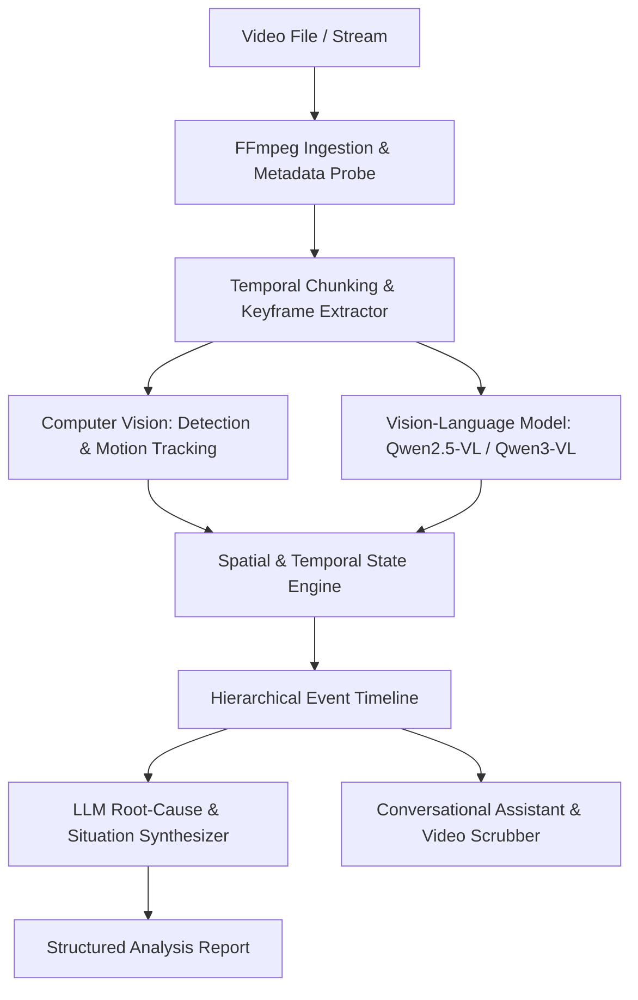
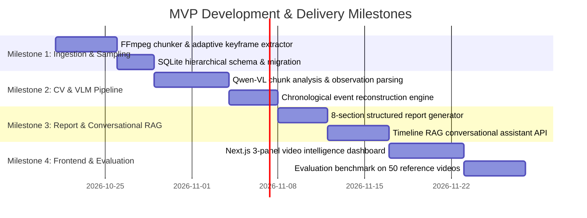

# AI Video Intelligence and Situation Analysis Platform
## Master Product Specification, Concrete MVP Scope & Measurable Success Criteria

---

## 1. Project Overview

The project is an AI-powered video intelligence platform that can analyze videos of virtually any duration, understand events occurring within them, identify problems or unusual situations, and provide detailed, evidence-based explanations and recommendations through a conversational interface.

The system functions as an **intelligent video analyst** rather than a basic video summarizer. Its purpose is not merely to describe what appears on screen, but to understand the sequence of events, recognize meaningful changes, investigate what may have gone wrong, explain possible causes, and suggest useful next steps.

Users can upload a short clip, a long recording, or an entire video, specify what they want analyzed, and receive an organized report. They can also ask follow-up questions about the video through a conversational assistant that understands the analysis and can retrieve relevant moments with exact timestamps.

The platform supports general-purpose analysis across different types of videos, including industrial operations, demonstrations, security footage, machinery, daily activities, and physical tasks.

---

## 2. Core Objective

The primary objective is to develop an AI system that can:
- **Understand** what is happening throughout a video.
- **Reconstruct** events in strict chronological order.
- **Identify** mistakes, unexpected behavior, anomalies, inefficiencies, and potential risks where supported by evidence.
- **Explain** what may have caused an observed problem (root-cause analysis).
- **Distinguish** confirmed observations (facts) from uncertain interpretations (hypotheses).
- **Recommend** improvements based on the user's objective and available evidence.
- **Answer** conversational questions about specific moments or the entire recording.
- **Analyze** videos of varying durations without requiring the whole video to fit into a single model request.

---

## 3. Video Input and Duration Flexibility

The application provides a video upload interface accepting common container formats (`MP4`, `MOV`, `MKV`, `AVI`, `WebM`) with configurable analysis options.

### Duration Tiers
- **Micro-clips**: 5 seconds to 1 minute.
- **Standard recordings**: 1 minute to 15 minutes.
- **Extended recordings**: 15 minutes to 1 hour (MVP ceiling), scalable to 3+ hours in production.
- **Temporal sub-range**: Users can define `start_time` and `end_time` to inspect specific segments.

### Non-Monolithic Processing (Chunking)
Video duration is decoupled from LLM/VLM context window constraints:
1. Long videos are segmented into temporal chunks (e.g., 30–60 second windows).
2. Keyframes are sampled adaptively based on scene motion and visual difference.
3. Observations are preserved in a structured database timeline.
4. Hierarchical summarization synthesizes segment-level findings into a cohesive video-level understanding.

---

## 4. Intelligent Video Understanding

The platform combines multi-modal AI capabilities rather than relying on a single monolithic model:

- **Perception Layer**: Identifies people, objects, equipment, spatial boundaries, and motion vectors.
- **Visual-Language Reasoning**: Interprets complex actions, posture, interaction anomalies, and qualitative scene states.
- **Evidence Verification**: Strictly differentiates direct visual observations from inferences, noting when evidence is incomplete or ambiguous.

---

## 5. Event Timeline and Memory Hierarchy

To analyze long recordings without losing critical micro-details, memory is organized hierarchically:

1. **Level 1 — Frame & Observation Level**: Raw object detections, bounding coordinates, motion deltas, and timestamped snapshots.
2. **Level 2 — Segment Level (30s–60s)**: Local summaries capturing continuous activities, entries, exits, and state changes.
3. **Level 3 — Event Level**: Deduplicated, correlated incidents spanning multiple observations (e.g., "Worker entered danger perimeter at 04:12, reached machine at 04:18, flagged for absent hardhat").
4. **Level 4 — Video Level**: Global narrative, pattern analysis, recurring anomalies, and overall process assessment.

---

## 6. Problem Detection and Root-Cause Reasoning

The analytical engine operates on a three-tier taxonomy:

| Category | Definition | Example |
|---|---|---|
| **Observed Facts** | Verified directly from visible pixels and telemetry. | *"Object fell from conveyor at 03:24. Operator stepped backward."* |
| **Possible Explanations** | Plausible hypotheses explaining why an event occurred. | *"Conveyor belt speed may have surged, or load was improperly balanced."* |
| **Recommendations** | Practical, prioritized actions to prevent recurrence. | *"Inspect conveyor roller bearings; verify maximum load limits on loading gate."* |

---

## 7. Automated Analysis Report Structure

Every completed analysis generates a structured, human-readable report with 8 core sections:
1. **Executive Summary**: High-level synopsis of events, overall status, and top findings.
2. **Chronological Reconstruction**: Step-by-step event timeline with precise `MM:SS` timestamps.
3. **Important Observations**: Key activities, procedural steps, and notable baseline behaviors.
4. **Problems, Inefficiencies & Errors**: Confirmed violations, safety hazards, equipment stalls, or anomalies.
5. **Possible Root Causes**: Evidence-backed explanations with explicit confidence levels and alternatives.
6. **Actionable Recommendations**: Prioritized corrective measures.
7. **Evidence & Timestamps**: Deep links to exact keyframes, cropped snapshots, and video playback offsets.
8. **Confidence & Limitations**: Explicit boundaries of what could not be determined from the footage.

---

## 8. Conversational AI Assistant

A dedicated conversational interface grounded in the video's hierarchical memory allows operators to query the footage:
- Answers cite exact timestamps (e.g., `[02:14]`).
- Clicking a timestamp seeks the video player directly to that instant.
- Retains context across multi-turn investigations.
- Honestly declares when questions cannot be answered from the provided footage.

---

## 9. Concrete MVP Scope (Phase 1)

The Minimum Viable Product (MVP) focuses on delivering an end-to-end working system that validates the core value proposition: **evidence-based video understanding over time without context-window limitations**.

### 9.1 In-Scope for MVP

#### A. Video Ingestion & Processing
- **File Upload**: Direct browser upload for `MP4`, `MOV`, `WebM` files up to **500 MB**.
- **Duration Support**: Clips from **10 seconds up to 30 minutes** (tested up to 60 minutes).
- **Temporal Sub-Range**: User-selectable start and end time markers for targeted analysis.
- **Intelligent Chunking Engine**: Local FFmpeg pipeline dividing videos into 30–60s segments with uniform keyframe sampling (1–2 FPS) and scene-change detection.
- **Processing Queue**: Local background task execution with step-by-step progress reporting (0%–100%) and stage notifications (`Uploading → Sampling → Visual Analysis → Event Extraction → Synthesizing Report`).

#### B. Understanding & Reasoning Pipeline
- **Dual-Engine Vision Pipeline**:
  - Fast CV object & person detection (YOLOv8 + ByteTrack).
  - Vision-Language Model interpretation for keyframes using **Qwen2.5-VL / Qwen3-VL** (via local Ollama or high-throughput API).
- **Core Domain Benchmark**: Industrial safety, equipment operation, SOP compliance, and physical demonstration tasks.
- **Custom Analysis Goal**: Optional user prompt input (e.g., *"Focus on whether proper lock-out tag-out procedure was followed"*).

#### C. Hierarchical Memory & Event Timeline
- **Persistent Storage**: SQLite (with SQLAlchemy async engine) storing:
  - Video metadata and chunk records.
  - Timestamped event timeline entries with confidence scores.
  - Saved keyframe paths and forensic crops.
  - Final analysis reports and conversational transcripts.
- **Structured Timeline Reconstruction**: Automatic deduplication and temporal aggregation of raw detections into continuous events.

#### D. Automated Report Generation
- Complete generation of all 8 standardized report sections.
- Markdown and JSON export capabilities.
- Direct timestamp deep-linking (`MM:SS`) allowing users to click any claim and jump the video player to that moment.

#### E. Conversational Video Assistant
- **RAG Architecture**: Retrieval-Augmented Generation indexing timeline events, visual descriptions, and segment summaries.
- **Timestamp-Grounded Answers**: Every factual response provides timestamp references.
- **Honesty Constraint**: Strict system prompt preventing the assistant from hallucinating events outside the recorded footage.
- **Multi-turn Chat**: Preserves conversation history within the analysis session.

#### F. Operator Web Interface (Next.js)
- **Unified 3-Panel Workspace**:
  - *Left Panel*: Video player with synced timeline scrubber and keyframe strip.
  - *Center Panel*: Dynamic Analysis Report with tabbed views (Executive Summary, Chronological Timeline, Root Causes, Recommendations).
  - *Right Panel*: Interactive Conversational Assistant chat window with suggested quick questions.
- **Task Management**: Upload modal, progress bars, and recent analysis history drawer.

---

### 9.2 Explicitly Out-of-Scope for MVP (Deferred to v1.1+)

| Feature | Deferred To | Rationale for MVP Exclusion |
|---|---|---|
| **Audio Transcription (Whisper)** | Phase 2 (v1.1) | MVP focuses purely on visual understanding and timeline reconstruction. |
| **Live Multi-RTSP Streaming VLM** | Phase 2 (v1.1) | Real-time multi-camera streaming introduces network latency variables separate from core video reasoning. |
| **Distributed Cluster (Redis/Celery)** | Phase 3 (v2.0) | Local FastAPI background tasks are sufficient for single-node evaluation and developer testing. |
| **Multi-Video Cross-Correlation** | Phase 3 (v2.0) | Multi-camera re-identification across different video files requires specialized spatial-temporal graphs. |
| **Model Fine-Tuning Pipeline** | Phase 3 (v2.0) | Pre-trained VLMs (Qwen2.5-VL / Qwen3-VL) provide sufficient zero-shot contextual reasoning. |
| **Automated Video Editing / Export Clip Montage** | Phase 2 (v1.2) | Generating custom edited highlight reels adds rendering overhead without improving analytical depth. |

---

### 9.3 MVP Phased Implementation Roadmap

- **Milestone 1**: Robust video file ingestion, FFmpeg chunking, keyframe caching, and database models.
- **Milestone 2**: Vision-language segment analysis, temporal event reconstruction, and observation aggregation.
- **Milestone 3**: Automated 8-section report generation and timeline-grounded conversational assistant.
- **Milestone 4**: Interactive 3-panel Next.js dashboard, video timestamp seeking, and benchmark validation.

---

## 10. Measurable Success Criteria

### 10.1 Video Processing and Duration Flexibility

| Success Metric | Target | Measurement Method |
|---|---|---|
| **Supported video formats** | ≥ 95% of valid test files in declared formats (`MP4`, `MOV`, `MKV`, `WebM`) | Test 100 valid video files across supported formats and encoding variations |
| **Duration coverage** | Successfully process test videos lasting 10s, 1m, 10m, 30m, and 60m | Run end-to-end tests across duration tiers |
| **Segment coverage** | 100% of scheduled video chunks processed in completed jobs | Compare processed chunk records against segment plan |
| **Timestamp accuracy** | Median event timestamp error ≤ 2.0 seconds against ground truth | Compare detected timestamps with manually verified event times |
| **Long-video continuity** | 100% chronological ordering preserved across chunk boundaries | Audit timeline monotonic continuity at segment seams |
| **Failed-job handling** | Resumable processing without re-analyzing completed chunks | Interrupt and restart processing during test runs |

### 10.2 Video Understanding and Event Detection

| Success Metric | Target | Measurement Method |
|---|---|---|
| **Event detection precision** | ≥ 85% | Measure proportion of predicted events matching annotated events |
| **Event detection recall** | ≥ 80% | Measure proportion of annotated reference events detected |
| **Event timeline quality** | ≥ 90% of major events placed in correct chronological sequence | Evaluate generated timeline order against reference logs |
| **Evidence linkage** | ≥ 95% of important factual claims linked to timestamp/keyframe | Audit random sample of generated analysis reports |
| **Duplicate event rate** | < 5% duplicate entries in final event timeline | Measure recurring event descriptions within overlapping windows |

### 10.3 Analysis and Root-Cause Reasoning

| Success Metric | Target | Measurement Method |
|---|---|---|
| **Factual accuracy** | ≥ 90% of audited claims directly supported by footage | Reviewers verify claims against video evidence |
| **Unsupported claims** | ≤ 5% of audited claims ungrounded or speculative | Label statements as supported, contradicted, or unverifiable |
| **Major-issue detection** | ≥ 80% recall for predefined benchmark issues | Compare analysis reports with expert-annotated incident logs |
| **Explanation quality** | Average rating ≥ 4.0 / 5.0 from qualified reviewers | Score correctness, reasoning structure, relevance, and clarity |
| **Recommendation usefulness** | ≥ 80% of recommendations rated actionable | Review recommendations against domain procedures |
| **Uncertainty handling** | ≥ 90% of ambiguous/insufficient-evidence cases correctly flagged | Evaluate dedicated test set of incomplete or occluded scenes |

### 10.4 Conversational Assistant

| Success Metric | Target | Measurement Method |
|---|---|---|
| **Answer accuracy** | ≥ 90% of answerable benchmark questions answered correctly | Evaluate timestamp, sequence, and causal questions |
| **Retrieval accuracy** | ≥ 90% of questions retrieve relevant event or keyframe | Compare retrieved evidence against ground-truth labels |
| **Timestamp references** | ≥ 90% of answers cite timestamp within 2.0s tolerance | Compare answer citations with annotated incident offsets |
| **Context retention** | ≥ 90% accuracy on multi-turn follow-up queries | Test conversational queries referring to earlier turns |
| **Hallucination rejection** | ≥ 90% of unanswerable questions acknowledge missing evidence | Test queries regarding occluded or out-of-frame activity |
| **Response latency** | Median response time < 8 seconds for timeline queries | Measure submission to first token on reference hardware |

### 10.5 Processing Performance and System Reliability

| Success Metric | Target | Measurement Method |
|---|---|---|
| **Processing completion rate** | ≥ 95% of valid benchmark jobs complete without unhandled exception | Run automated 50-video batch test suite |
| **Progress reporting** | Progress updates emitted at least every 3 seconds | Monitor WebSocket / polling progress stream during jobs |
| **Interface responsiveness** | Dashboard and chat remain 100% interactive during background analysis | Run concurrent user interactions during long-video processing |
| **Resource ceiling** | Peak RAM ≤ 16 GB, GPU VRAM ≤ 12 GB on standard workstation | Profile system memory during peak chunk analysis |

### 10.6 User Experience & Evidence Navigation

| Success Metric | Target | Measurement Method |
|---|---|---|
| **Task completion** | ≥ 90% of first-time users can upload, analyze, and inspect findings | Usability test with representative operators |
| **Evidence navigation** | 100% of report timestamp chips click-to-seek video player | Automated browser UI click-and-seek test |
| **Report export** | 100% valid Markdown and JSON export generation | Test export downloads on all completed analyses |

---

## 11. Acceptance & Evaluation Protocol

1. **Held-Out Evaluation Dataset**: 50 benchmark videos across industrial safety, equipment operation, and physical demonstrations, with ground-truth event timelines, root-cause annotations, and standard Q&A pairs.
2. **Double-Blind Review**: Factual claims audited by reviewers comparing system findings against raw footage.
3. **Release Gate**: All Phase 1 MVP targets must be verified before moving to Phase 2 (Audio & Multi-Camera integration).
