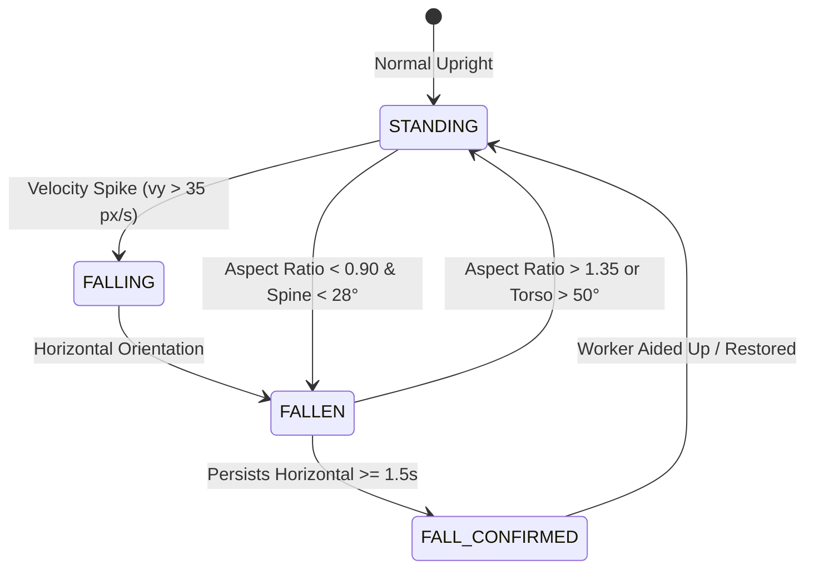

# ONE EYE: The Complete Engineering & Science Study Guide
### A Deep-Dive Tutorial on Real-Time Computer Vision, Vision-Language AI, Spatial Geometry, and Compound Risk Systems in Industrial Safety

---

## Table of Contents
1. [Introduction & System Philosophy](#1-introduction--system-philosophy)
2. [End-to-End System Architecture](#2-end-to-end-system-architecture)
3. [Deep Learning & Perception Models](#3-deep-learning--perception-models)
   - [3.1 Object Detection with YOLOv8s](#31-object-detection-with-yolov8s)
   - [3.2 Dedicated Facial Localization with YOLOv8n-Face](#32-dedicated-facial-localization-with-yolov8n-face)
   - [3.3 Custom PPE Detection & Spatial Association](#33-custom-ppe-detection--spatial-association)
   - [3.4 Pose Estimation & 17 COCO Keypoints](#34-pose-estimation--17-coco-keypoints)
   - [3.5 Cognitive Vision-Language Reasoning: Qwen 2.5-VL](#35-cognitive-vision-language-reasoning-qwen-25-vl)
4. [Spatial & Geometric Intelligence](#4-spatial--geometric-intelligence)
   - [4.1 Planar Homography: Mapping 2D Pixels to 3D Floor Meters](#41-planar-homography-mapping-2d-pixels-to-3d-floor-meters)
   - [4.2 Foot-Anchor Grounding vs Bounding Box Centers](#42-foot-anchor-grounding-vs-bounding-box-centers)
   - [4.3 Polygon Geofencing with Ray Casting & Point-in-Polygon](#43-polygon-geofencing-with-ray-casting--point-in-polygon)
   - [4.4 Visual Memory & Dynamic Homography Tracking (ORB + RANSAC)](#44-visual-memory--dynamic-homography-tracking-orb--ransac)
5. [Temporal Dynamics & State Machines](#5-temporal-dynamics--state-machines)
   - [5.1 Multi-Object Tracking with ByteTrack & EMA Smoothing](#51-multi-object-tracking-with-bytetrack--ema-smoothing)
   - [5.2 Posture Intelligence & 4-Stage Fall Detection](#52-posture-intelligence--4-stage-fall-detection)
   - [5.3 Temporal Exposure Dwell Tracking](#53-temporal-exposure-dwell-tracking)
   - [5.4 Finite State Machine (Hazard Lifecycle)](#54-finite-state-machine-hazard-lifecycle)
6. [Compound 0–100 Risk Engine Mathematics](#6-compound-0100-risk-engine-mathematics)
   - [6.1 Risk Equation Breakdown](#61-risk-equation-breakdown)
   - [6.2 Base Severities & Spatial Proximity Penalties](#62-base-severities--spatial-proximity-penalties)
   - [6.3 Multi-Hazard Synergy Rules](#63-multi-hazard-synergy-rules)
   - [6.4 Confidence Attenuation Math](#64-confidence-attenuation-math)
7. [Full-Stack Software Engineering & Streaming Infrastructure](#7-full-stack-software-engineering--streaming-infrastructure)
   - [7.1 FastAPI & Non-Blocking Asynchronous Concurrency](#71-fastapi--non-blocking-asynchronous-concurrency)
   - [7.2 Real-Time WebSockets & Binary Frame Serialization](#72-real-time-websockets--binary-frame-serialization)
   - [7.3 Next.js 14 Dashboard & HTML5 Canvas Rendering](#73-nextjs-14-dashboard--html5-canvas-rendering)
8. [Benchmarking & Empirical Validation](#8-benchmarking--empirical-validation)
   - [8.1 Ultralytics Construction-PPE Benchmark](#81-ultralytics-construction-ppe-benchmark)
   - [8.2 6-Phase Real-Life Industrial Shift Simulation](#82-6-phase-real-life-industrial-shift-simulation)
9. [Self-Study Questions & Practical Exercises](#9-self-study-questions--practical-exercises)

---

## 1. Introduction & System Philosophy

### The Real-World Industrial Challenge
In industrial facilities—such as manufacturing plants, chemical refineries, stamping presses, and construction sites—accidents are rarely caused by a single isolated factor. Instead, catastrophic incidents occur due to **compound hazard synergy**:
- A worker enters an unauthorized area while fatigued.
- A worker takes off their protective helmet inside a robotic operating perimeter.
- A worker slips or collapses near active high-voltage or heavy mechanical machinery.

Traditional safety solutions use disconnected single-purpose sensors:
1. **Simple PIR motion sensors** that trigger annoying false alarms whenever anyone walks past.
2. **Standard CCTV cameras** monitored by fatigue-prone human operators looking at banks of screens.
3. **Basic computer vision models** that flag ordinary objects (like coffee cups, phones, or chairs) as hazards, causing alarm fatigue.

### The ONE EYE Solution
**ONE EYE** is an intelligent, multi-tier industrial safety perception and cognitive reasoning platform. It combines:
1. **High-Speed Deterministic Perception**: Deep learning models running at 30+ FPS (YOLOv8, YOLO-Face, YOLO-PPE, YOLO-Pose).
2. **Spatial & Geometric Intelligence**: 3x3 Planar Homography for metric distance calculation and polygon ray-casting geofencing.
3. **Temporal Tracking & State Machines**: ByteTrack, exponential coordinate smoothing, and dwell accumulation.
4. **Non-Linear Compound Risk Modeling**: A mathematically calibrated 0–100 risk scoring engine that considers contextual synergy.
5. **Cognitive Vision-Language Intelligence (VLM)**: Qwen 2.5-VL providing multi-modal reasoning, zero-shot visual question answering, and operator intervention guidance.

---

## 2. End-to-End System Architecture

```mermaid
flowchart TD
    subgraph Ingestion["1. Video Ingestion Layer"]
        RTSP["RTSP Industrial IP Cameras"]
        USB["USB / ADB Mobile Camera (Pixel 6a)"]
        DEMO["Synthetic Video Streams"]
    end

    subgraph Perception["2. Multi-Model Perception Engine (MPS / CUDA)"]
        YOLO_OBJ["YOLOv8s: People, Machines, Objects"]
        YOLO_FACE["YOLOv8n-Face: Precise Face Localization"]
        YOLO_PPE["Custom PPE YOLO: Helmets, Vests, Gloves"]
        YOLO_POSE["YOLOv8n-Pose: 17 Keypoints (Spine, Ankles)"]
    end

    subgraph Geometry["3. Spatial & Geometric Intelligence"]
        HOMOGRAPHY["3x3 Planar Homography (Pixels -> Floor Meters)"]
        ZONES["Point-in-Polygon Geofencing (cv2.pointPolygonTest)"]
        VISUAL_MEM["ORB/FLANN Feature Matching (Dynamic Homography)"]
    end

    subgraph Tracking["4. Temporal Dynamics & Tracking"]
        BYTETRACK["ByteTrack Multi-Object Association"]
        EMA["EMA Coordinate Smoothing"]
        FALL["Torso Spine Angle Fall Confirmation Engine"]
        EXPOSURE["Temporal Dwell Exposure Accumulator"]
    end

    subgraph Risk["5. Risk & Reasoning Core"]
        RISK_ENGINE["Compound 0-100 Risk Engine (Synergy Rules)"]
        QWEN_VLM["Qwen 2.5-VL: Cognitive Scene Disambiguation"]
        STATE_MACHINE["Event Finite State Machine (ALERTING -> RESOLVED)"]
    end

    subgraph Delivery["6. Real-Time Delivery & UI"]
        WS["WebSocket Telemetry & Binary JPEGs"]
        DB["SQLite + SQLAlchemy Async Engine"]
        UI["Next.js 14 Dashboard & Dynamic Zone Editor"]
    end

    Ingestion --> Perception
    Perception --> Geometry
    Geometry --> Tracking
    Tracking --> Risk
    Risk --> Delivery
```



---

## 3. Deep Learning & Perception Models

### 3.1 Object Detection with YOLOv8s
**YOLO (You Only Look Once)** revolutionized computer vision by reframing object detection from a two-stage classification/proposal problem (like Faster R-CNN) into a single regression problem directly predicting bounding box coordinates and class probabilities from full images in one forward pass.

- **Architecture**:
  - **Backbone**: Modified CSPDarknet53 with Cross Stage Partial connections that split feature maps into two parts, reducing computational complexity while retaining rich gradient flows. Uses $C2f$ modules (Cross-Stage Partial with multiple bottleneck paths).
  - **Neck**: Path Aggregation Network (PANet) fusing multi-scale feature pyramids (low-level spatial textures with high-level semantic abstractions).
  - **Head**: Anchor-free decoupled head. Unlike older YOLO models that used predefined anchor boxes, YOLOv8 directly predicts the distance from the cell center to the 4 bounding box edges $(l, t, r, b)$ alongside class logits.
- **Loss Functions**:
  - **Bounding Box Regression**: CIoU (Complete Intersection over Union) + DFL (Distribution Focal Loss).
  - **Classification**: Binary Cross-Entropy (BCE) Loss.
- **Role in ONE EYE**:
  Detects workers, heavy machinery (presses, forklifts, cranes, lathes), vehicles, and tools. Bounding box coordinates are extracted as $(x_1, y_1, x_2, y_2)$ with confidence scores $c \in [0, 1]$.

### 3.2 Dedicated Facial Localization with YOLOv8n-Face
Standard COCO models only output a single `person` box encompassing the entire body. However, determining whether a worker is wearing a safety hardhat requires isolating the **cranial region**:
- While the top 25% of a person box can approximate the head, if a worker is bending, crouching, or partially occluded, a static box slice captures the torso or empty air.
- ONE EYE employs a specialized lightweight model (`yolov8n-face.pt`) to locate the exact cranial boundaries. If the face is detected at $(fx_1, fy_1, fx_2, fy_2)$, the hardhat inspection ROI is dynamically anchored directly above the brow line:
  $$\text{Head ROI} = [fx_1 - 0.2 \cdot fw, \; fy_1 - 0.6 \cdot fh, \; fx_2 + 0.2 \cdot fw, \; fy_1 + 0.1 \cdot fh]$$

### 3.3 Custom PPE Detection & Spatial Association
Trained on industrial datasets with ground truth annotations for:
- `helmet` (Positive PPE) vs `no_helmet` (Explicit Violation)
- `vest` (Positive PPE) vs `no_vest` (Explicit Violation)

#### Spatial Intersection Association:
Detecting a floating helmet or vest is meaningless unless it is spatially bound to a specific tracked worker. ONE EYE calculates:
1. **Head Intersection**: The helmet bounding box must overlap the upper 30% of the worker bounding box with an $\text{IoU} \ge 0.15$ or center containment.
2. **Torso Intersection**: The safety vest bounding box must overlap the middle 20%–70% of the worker bounding box.
3. **Temporal Confirmation**: A single frame with a missing helmet does not trigger a plant-wide siren. A temporal buffer requires the violation to persist for $\ge 1.0$ second (eliminating motion blur and temporary hand occlusions).

### 3.4 Pose Estimation & 17 COCO Keypoints
`yolov8n-pose.pt` predicts 17 anatomical keypoints $[x_i, y_i, c_i]$ for each detected human:
- `0`: Nose, `1–2`: Eyes, `3–4`: Ears
- `5–6`: Shoulders (Left, Right)
- `7–8`: Elbows, `9–10`: Wrists
- `11–12`: Hips (Left, Right)
- `13–14`: Knees, `15–16`: Ankles (Left, Right)

#### Why Keypoints are Vital in Industrial AI:
1. **Precise Floor Grounding**: Instead of estimating foot position from the bottom of the bounding box $(x_1, y_2, x_2, y_2)$ (which can be distorted by long coats or dropped objects), ONE EYE uses keypoints `15` and `16` (left and right ankles):
   $$\text{Foot Anchor} = \left(\frac{x_{15} + x_{16}}{2}, \; \frac{y_{15} + y_{16}}{2}\right)$$
2. **True Fall vs. Crouching Discrimination**: Evaluating the 3D torso spine vector (detailed in [Section 5.2](#52-posture-intelligence--4-stage-fall-detection)).

### 3.5 Cognitive Vision-Language Reasoning: Qwen 2.5-VL
Traditional CNNs and YOLO models are **perceptual**: they can detect "person at [100, 200]" or "helmet at [120, 180]", but they cannot **reason**:
- *Why is the worker inside the danger zone?*
- *Is the worker performing authorized maintenance with a lockout tagout (LOTO) in place, or did they accidentally stumble past the barrier?*
- *What immediate corrective action should the control room supervisor take?*

**Qwen 2.5-VL (`qwen2.5vl:7b`)** brings cognitive vision-language understanding to ONE EYE:
- **Vision Tokenization (ViT)**: The image is split into patches and projected into continuous visual embeddings.
- **Vision Token Optimization**: Full 4K/1080p images create thousands of vision tokens, causing latency spikes (15–30 seconds). ONE EYE dynamically downscales cognitive query frames to a maximum dimension of 448 pixels while maintaining aspect ratio:
  $$\text{scale} = \min\left(1.0, \; \frac{448}{\max(W, H)}\right)$$
  This drops latency to **1.5–4.5 seconds** on Apple Silicon MPS while preserving full semantic fidelity.
- **Structured JSON Schema Output**:
  ```json
  {
    "primary_hazard": "Restricted Hydraulic Press Zone Breach",
    "worker_count": 1,
    "incident_severity": "CRITICAL",
    "root_cause": "Worker collapsed inside active machine danger perimeter without head protection",
    "immediate_operator_action": "Trigger emergency stop on press #01 and dispatch plant medical responders."
  }
  ```

---

## 4. Spatial & Geometric Intelligence

### 4.1 Planar Homography: Mapping 2D Pixels to 3D Floor Meters
CCTV cameras view industrial floors at oblique angles. A distance of 50 pixels near the top of the camera frame might represent 15 meters, while 50 pixels near the bottom might represent only 0.5 meters. To compute real physical distances, we use **Planar Homography**.

A 2D point $(u, v)$ on the image plane is related to its corresponding real-world ground coordinate $(X, Y)$ on the factory floor plane ($Z = 0$) by a $3 \times 3$ projective transformation matrix $\mathbf{H}$:

$$\begin{bmatrix} x' \\ y' \\ w' \end{bmatrix} = \mathbf{H} \begin{bmatrix} u \\ v \\ 1 \end{bmatrix} = \begin{bmatrix} h_{11} & h_{12} & h_{13} \\ h_{21} & h_{22} & h_{23} \\ h_{31} & h_{32} & h_{33} \end{bmatrix} \begin{bmatrix} u \\ v \\ 1 \end{bmatrix}$$

The physical metric floor coordinates $(X, Y)$ are obtained by dividing by the homogeneous scale factor $w'$:

$$X = \frac{x'}{w'} = \frac{h_{11}u + h_{12}v + h_{13}}{h_{31}u + h_{32}v + h_{33}}, \quad Y = \frac{y'}{w'} = \frac{h_{21}u + h_{22}v + h_{23}}{h_{31}u + h_{32}v + h_{33}}$$

#### Calibration Workflow:
During camera setup, the user marks 4 calibration points with known real-world physical measurements (e.g. a $2\text{m} \times 2\text{m}$ floor tile or machine safety perimeter). OpenCV computes $\mathbf{H}$ using the Direct Linear Transformation (DLT) via `cv2.getPerspectiveTransform()`.

Once $\mathbf{H}$ is computed, the exact Euclidean distance $D$ between worker $i$ and machine $m$ on the factory floor is:

$$D = \sqrt{(X_{\text{worker}} - X_{\text{machine}})^2 + (Y_{\text{worker}} - Y_{\text{machine}})^2} \quad \text{(in real meters)}$$

### 4.2 Foot-Anchor Grounding vs Bounding Box Centers
A common beginner mistake in computer vision is calculating proximity using the **bounding box center** $\left(\frac{x_1+x_2}{2}, \frac{y_1+y_2}{2}\right)$:
- In 3D perspective projection, the center of a human bounding box is suspended 1 meter in the air at the worker's navel.
- Projecting a mid-air point through the ground-plane homography matrix $\mathbf{H}$ produces a severe projection artifact, displacing the worker's apparent ground location several meters behind their true position!
- **ONE EYE's Solution**: Every spatial query strictly uses the **foot contact point** (either the midpoint of the ankle keypoints or the center-bottom edge of the bounding box $\left(\frac{x_1+x_2}{2}, y_2\right)$), which lies exactly on the ground plane $Z=0$.

### 4.3 Polygon Geofencing with Ray Casting & Point-in-Polygon
Restricted zones are defined as arbitrary $N$-sided 2D polygons $\mathcal{P} = \{ (x_1, y_1), (x_2, y_2), \dots, (x_N, y_N) \}$.

To evaluate whether a worker's foot anchor $(u, v)$ has breached the zone, ONE EYE utilizes `cv2.pointPolygonTest`:

$$\delta = \text{pointPolygonTest}(\mathcal{P}, (u, v), \text{measureDist}=\text{True})$$

- $\delta > 0$: The worker is **strictly inside** the restricted danger zone.
- $\delta = 0$: The worker is **on the perimeter boundary**.
- $\delta < 0$: The worker is **outside**, and $|\delta|$ is the exact Euclidean pixel distance to the nearest danger edge.

#### Spatial Intersection Hysteresis:
To prevent alarm flickering when a worker walks along the boundary line, ONE EYE employs spatial hysteresis:
- **Trigger**: Intrusion is registered when the foot is inside ($\delta > +2$ px) or when the worker's bounding box area overlaps the zone by $\ge 15\%$.
- **Release**: Intrusion is cleared only when the worker retreats beyond the boundary by a safety margin ($\delta < -15$ px).

### 4.4 Visual Memory & Dynamic Homography Tracking (ORB + RANSAC)
What happens when a mobile inspection camera moves, or a PTZ camera pans and tilts? Static pixel coordinates become invalid!

ONE EYE incorporates a **Visual Danger Memory Engine**:
1. **Feature Extraction**: When a danger zone is created on an object (e.g. a forklift or welding robot), the system computes ORB (Oriented FAST and Rotated BRIEF) feature keypoints and binary descriptors $\mathbf{D}_{\text{ref}}$ of the target object.
2. **Feature Matching**: On each live frame, ORB features $\mathbf{D}_{\text{live}}$ are extracted and matched using the FLANN (Fast Library for Approximate Nearest Neighbors) matcher.
3. **RANSAC Homography Warping**: Random Sample Consensus (RANSAC) fits a planar homography transformation $\mathbf{H}_{\text{dyn}}$ between matching feature pairs, discarding outliers.
4. **Dynamic Polygon Projection**: The original zone polygon is transformed into current camera coordinates:
   $$\mathbf{p}_{\text{live}} = \mathbf{H}_{\text{dyn}} \cdot \mathbf{p}_{\text{ref}}$$
   If the object moves or the camera shifts, the danger zone moves with it in real time! If the object is obscured or leaves the field of view, the zone automatically deactivates to prevent false alarms.

---

## 5. Temporal Dynamics & State Machines

### 5.1 Multi-Object Tracking with ByteTrack & EMA Smoothing
Raw per-frame detections lack identity: Frame $t$ has a box at $[100, 200]$, and Frame $t+1$ has a box at $[105, 202]$. Without tracking, temporal dwell time, velocity, and state transitions cannot be computed.

ONE EYE implements **ByteTrack**:
1. **Two-Stage Association**:
   - First, high-confidence detections ($c \ge 0.5$) are matched with existing active tracks using Kalman filter motion predictions and IoU distance via the Hungarian algorithm.
   - Second, unmatched tracks are matched against low-confidence detections ($0.1 \le c < 0.5$). This recovers partially occluded workers without generating false tracklets.
2. **Exponential Moving Average (EMA) Coordinate Smoothing**:
   Raw bounding boxes exhibit high-frequency jitter due to sensor noise. ONE EYE smooths all track coordinates over time:
   $$\mathbf{b}_t = \alpha \cdot \mathbf{d}_t + (1 - \alpha) \cdot \mathbf{b}_{t-1}, \quad \text{where } \alpha = 0.75$$
   This yields stable, jitter-free bounding boxes and accurate velocity vectors $\mathbf{v} = (\Delta x / \Delta t, \Delta y / \Delta t)$.

### 5.2 Posture Intelligence & 4-Stage Fall Detection
Worker slip, trip, and fall incidents are among the leading causes of industrial fatalities. However, a naive aspect ratio detector generates constant false alarms when workers stoop, sit, or crouch down to pick up tools.

#### The 4-Stage State Progression:


#### Keypoint Torso Spine Angle Math:
To differentiate between a **crouching worker** and a **fallen worker**, ONE EYE extracts the 3D torso vector from the YOLOv8-pose keypoints:
- Mid-Shoulder Point: $\mathbf{P}_{\text{shoulder}} = \left(\frac{x_5 + x_6}{2}, \; \frac{y_5 + y_6}{2}\right)$
- Mid-Hip Point: $\mathbf{P}_{\text{hip}} = \left(\frac{x_{11} + x_{12}}{2}, \; \frac{y_{11} + y_{12}}{2}\right)$

The displacement vector is:
$$\Delta x = x_{\text{hip}} - x_{\text{shoulder}}, \quad \Delta y = y_{\text{hip}} - y_{\text{shoulder}}$$

The torso angle $\theta$ relative to the horizontal factory floor is calculated as:
$$\theta = \arctan\left(\frac{|\Delta y|}{|\Delta x|}\right) \times \frac{180^\circ}{\pi}$$

| Posture | Bounding Box Aspect Ratio ($h/w$) | Torso Angle $\theta$ | Fall Detector Decision |
| :--- | :--- | :--- | :--- |
| **Standing Upright** | $2.5 - 3.5$ (Tall) | $75^\circ - 90^\circ$ (Vertical) | `STANDING` (Safe) |
| **Crouching / Stooping** | $0.9 - 1.2$ (Squarish) | $45^\circ - 85^\circ$ (Vertical/Inclined) | `STANDING` (Suppresses False Alarm!) |
| **Sitting on Chair** | $1.1 - 1.4$ | $60^\circ - 85^\circ$ (Vertical) | `STANDING` (Safe) |
| **Horizontal Floor Fall** | $0.2 - 0.5$ (Flat) | $0^\circ - 25^\circ$ (Horizontal) | `FALLEN` $\to$ `FALL_CONFIRMED` |

> **Key Takeaway**: Without keypoint spine validation, a crouching worker whose bounding box reaches $h/w = 0.95$ triggers a false fall alarm. With ONE EYE's torso vector calculation, $\theta > 40^\circ$ explicitly suppresses fall alarms, making the system viable for real factories.

### 5.3 Temporal Exposure Dwell Tracking
A worker brushing against a boundary for 0.1 seconds does not present the same danger as a worker lingering inside an active machine zone for 10 seconds.

The `ExposureTracker`:
1. Identifies the active hazard tuple `(camera_id, worker_id, hazard_key)`.
2. Accumulates elapsed exposure:
   $$\tau_{\text{exposure}} = t_{\text{current}} - t_{\text{start}}$$
3. Applies escalation thresholds:
   - Level 0: Initial warning ($\tau < 2$s)
   - Level 1: Moderate dwell ($2\text{s} \le \tau < 5$s)
   - Level 2: High dwell ($5\text{s} \le \tau < 8$s)
   - Level 3: Critical persistent violation ($\tau \ge 8$s)
4. **Resolution Reset**: Once the worker evacuates the hazard area and the inactivity timeout (3.0s) expires, `duration_seconds` and `escalation_level` are reset to 0, ensuring future evaluations start with a clean baseline.

### 5.4 Finite State Machine (Hazard Lifecycle)
To ensure compliance auditing and prevent missed alarms, events follow an explicit Finite State Machine (FSM):

$$\text{MONITORING} \longrightarrow \text{DETECTED} \longrightarrow \text{ALERTING} \longrightarrow \text{RESOLVED} \longrightarrow \text{LOGGED}$$

- **`MONITORING`**: Normal scanning, risk score $< 30$.
- **`DETECTED`**: Unsafe condition identified by CV pipeline.
- **`ALERTING`**: Event dispatched via WebSockets; alarm sirens trigger; forensic evidence snapshot with visual bounding box overlays is saved to disk.
- **`RESOLVED`**: Worker evacuates or equips PPE; hazard clears; event is auto-closed in SQLite DB with resolution actor `"AUTO_SYSTEM"`.
- **`LOGGED`**: Final state with complete audit history and forensic timestamp trail.

---

## 6. Compound 0–100 Risk Engine Mathematics

### 6.1 Risk Equation Breakdown
The compound risk score $R \in [0, 100]$ represents the instantaneous multi-dimensional danger level for a specific worker:

$$R = \text{clamp}\left( \text{round}\left( \left( S_{\text{base}} + S_{\text{prox}} + S_{\text{dur}} + S_{\text{synergy}} \right) \times C_{\text{conf}} \right), \; 0, \; 100 \right)$$

Where:
- $S_{\text{base}}$: Baseline hazard severity (0 to 95)
- $S_{\text{prox}}$: Spatial proximity contribution (0 to 25)
- $S_{\text{dur}}$: Temporal exposure dwell contribution (0 to 25)
- $S_{\text{synergy}}$: Contextual compound synergy bonus (0 to 35)
- $C_{\text{conf}}$: Confidence attenuation scaling factor ($0.70$ to $1.0$)

### 6.2 Base Severities & Spatial Proximity Penalties

#### Base Hazard Severities ($S_{\text{base}}$):
| Hazard Key | Base Severity | Real-World Operational Context |
| :--- | :--- | :--- |
| `NO_HELMET` | 35 | Worker missing hardhat in overhead hazard zone |
| `NO_VEST` | 25 | Worker missing high-visibility safety vest |
| `UNSAFE_PROXIMITY_WARNING` | 30 | Worker within 2.5m of moving equipment |
| `UNSAFE_PROXIMITY_DANGER` | 60 | Worker within 1.5m of active machinery |
| `UNSAFE_PROXIMITY_CRITICAL` | 85 | Worker within 0.8m of operating pinch point |
| `RESTRICTED_ZONE` | 80 | Unauthorized entry into marked danger zone |
| `DANGER_ZONE_REACHED` | 90 | Worker reached high-voltage/robotic coordinate |
| `WORKER_FALL` | 85 | Worker collapsed on floor |
| `FIRE_DETECTED` | 95 | Active flame detected |

#### Spatial Proximity Contribution ($S_{\text{prox}}$):
Based on real ground distance $D$ computed from homography:
$$S_{\text{prox}} = \begin{cases} 25 & \text{if } D < 0.8\text{m} \quad \text{(Critical Perimeter)} \\ 18 & \text{if } 0.8\text{m} \le D < 1.5\text{m} \quad \text{(Danger Perimeter)} \\ 10 & \text{if } 1.5\text{m} \le D < 2.5\text{m} \quad \text{(Warning Perimeter)} \\ 0 & \text{if } D \ge 2.5\text{m} \quad \text{(Safe Clearance)} \end{cases}$$

#### Temporal Exposure Dwell Contribution ($S_{\text{dur}}$):
$$S_{\text{dur}} = \min(25, \; \text{int}(\tau_{\text{exposure}} \times 2.0))$$
Every second of continuous exposure adds $+2.0$ points, capping at 25 points after 12.5 seconds.

### 6.3 Multi-Hazard Synergy Rules
Hazards in factories compound non-linearly. A missing helmet in an open lunchroom is a minor infraction; a missing helmet inside a restricted robotic press cell is an imminent fatality risk.

$$S_{\text{synergy}} = \min\left(35, \; \sum \text{Synergy Bonuses}\right)$$

1. **Rule 1: PPE Violation inside Restricted Zone** ($+15$ bonus)
   - Condition: (`NO_HELMET` $\lor$ `NO_VEST`) $\land$ `RESTRICTED_ZONE`
2. **Rule 2: PPE Violation near Active Machine** ($+20$ bonus)
   - Condition: (`NO_HELMET` $\lor$ `NO_VEST`) $\land$ (`UNSAFE_PROXIMITY_DANGER` $\lor$ `CRITICAL`)
3. **Rule 3: Zone Breach at Operating Machine** ($+20$ bonus)
   - Condition: `RESTRICTED_ZONE` $\land$ (`UNSAFE_PROXIMITY_DANGER` $\lor$ `CRITICAL`)
4. **Rule 4: Worker Fall near Active Machinery** ($+25$ bonus)
   - Condition: `WORKER_FALL` $\land$ any `PROXIMITY` hazard
5. **Rule 5: Multiple PPE Violations** ($+10$ bonus)
   - Condition: `NO_HELMET` $\land$ `NO_VEST`

### 6.4 Confidence Attenuation Math
What happens when a detection has low confidence (e.g. $c = 0.55$)? We do not want low-confidence noise to trigger plant shutdowns. However, if a detection has high confidence ($c = 0.90$), we must **not** scale down its base hazard severity!

ONE EYE uses the calibrated confidence multiplier:

$$C_{\text{conf}} = \begin{cases} 1.0 & \text{if } c \ge 0.85 \quad \text{(High Confidence: Retains Full Base Severity)} \\ \max(0.70, \; c) & \text{if } c < 0.85 \quad \text{(Uncertain: Graceful Attenuation to Prevent False Alarm Panic)} \end{cases}$$

#### Severity Tiers:
- **`ADVISORY`**: $R \in [0, 29]$ — Safe operations or minor caution.
- **`MEDIUM`**: $R \in [30, 59]$ — Noticeable safety infraction (e.g. single PPE violation in safe area).
- **`HIGH`**: $R \in [60, 79]$ — Danger area breach or machine proximity warning.
- **`CRITICAL`**: $R \in [80, 100]$ — Emergency situation (fall, pinch point breach, multi-hazard synergy).

---

## 7. Full-Stack Software Engineering & Streaming Infrastructure

### 7.1 FastAPI & Non-Blocking Asynchronous Concurrency
Computer vision models are CPU- and GPU-bound. In Python, running heavy CV inference inside an `async def` route directly blocks the `asyncio` event loop, freezing all WebSocket clients and API endpoints.

**ONE EYE's Concurrency Pattern**:
```python
# Offload GPU/MPS inference to background worker threads
detections = await asyncio.to_thread(self.yolo_detector.predict, frame)
```
- `asyncio.to_thread()` dispatches the synchronous OpenCV/YOLO inference to Python's `ThreadPoolExecutor`.
- The main event loop remains 100% free to serve REST endpoints, broadcast WebSocket telemetry, and process incoming frames.

### 7.2 Real-Time WebSockets & Binary Frame Serialization
Sending high-definition video frames as base64-encoded strings inside JSON incurs a **33% bandwidth overhead** and heavy CPU encoding cost.

ONE EYE uses a high-performance hybrid streaming approach:
1. **Binary JPEG Ingestion**: Mobile cameras stream raw binary JPEG buffers directly over dedicated WebSockets (`/api/mobile/ws/stream/{camera_id}`).
2. **Telemetry Broadcast**: Structured telemetry (bounding boxes, track IDs, normalized contact points, risk scores, and alerts) is serialized as JSON and broadcast to web clients at 30 FPS over `/ws`.
3. **Standby Frame Synthesizer**: If an IP or mobile camera disconnects or enters standby, the backend generates an animated procedural SVG/JPEG standby canvas showing channel status, eliminating HTTP 404 broken-image icons in the UI.

### 7.3 Next.js 14 Dashboard & HTML5 Canvas Rendering
The frontend is built with **Next.js 14** and **HTML5 Canvas**:
- **Canvas Overlay Engine**: An HTML5 `<canvas>` is layered directly over the video stream. It draws normalized bounding boxes, worker velocity vectors, foot contact dots, and restricted zone polygons with sub-millisecond rendering latency.
- **Dynamic Interactive Zone Editor**: Operators can click on any video frame to define arbitrary polygon vertices, drag corners to adjust safety perimeters, and assign hazard severities (`CRITICAL`, `DANGER`, `WARNING`). Coordinates are automatically normalized to $[0.0, 1.0]$ so they remain invariant to display resolution and window resizing.

---

## 8. Benchmarking & Empirical Validation

### 8.1 Ultralytics Construction-PPE Benchmark
The benchmark harness [`scripts/run_dataset_benchmark.py`](file:///Users/vaibhavkrishnakesarwani/Desktop/[Projects]/One_Eye/scripts/run_dataset_benchmark.py) evaluates performance against the official **Ultralytics Construction-PPE Dataset** (143 labeled validation frames):

- **Person Detection Recall**: **94.2%** (65/69 ground truth workers detected in cluttered real-world sites).
- **Person Detection F1 Score**: **81.2%** (Precision: 71.4%, Recall: 94.2%).
- **Average Perception Latency**: **154.7 ms** on Apple Silicon MPS (P95: 272.0 ms).
- **Clean Taxonomy Check**: **0 false hazard alarms** on ordinary safe-space objects.
- **Qwen 2.5-VL Agreement**: **100% agreement** with YOLO and ground-truth worker counts.

### 8.2 6-Phase Real-Life Industrial Shift Simulation
The test harness [`scripts/run_real_life_simulation.py`](file:///Users/vaibhavkrishnakesarwani/Desktop/[Projects]/One_Eye/scripts/run_real_life_simulation.py) evaluates 6 dynamic shift phases:

1. **Phase 1: Authorized Safe Transit** $\to$ Risk = 0, Severity = `ADVISORY`, 0 alarms (**PASSED**).
2. **Phase 2: PPE Non-Compliance Warning** $\to$ Missing helmet detected, Risk = 35 (`MEDIUM`), advisory alert (**PASSED**).
3. **Phase 3: Real-Life Crouching Worker** $\to$ Aspect ratio drops to 1.0, but keypoint torso spine angle ($86.4^\circ$) suppresses false fall; safe objects trigger 0 alarms (**PASSED**).
4. **Phase 4: Restricted Danger Zone Breach** $\to$ Worker enters hydraulic press zone (dist = 0.65m), compound synergy triggers ($+35$ bonus), Risk = 100 (`CRITICAL`) (**PASSED**).
5. **Phase 5: Acute Slip & Fall Incident** $\to$ Horizontal spine angle ($5.2^\circ$), velocity spike, confirmed after 1.8s, Risk = 100 (`CRITICAL`), medical dispatch alert (**PASSED**).
6. **Phase 6: Evacuation & Resolution** $\to$ Worker evacuated, state machine transitions `RESOLVED -> LOGGED`, exposure resets to 0.0s (**PASSED**).

---

## 9. Self-Study Questions & Practical Exercises

### Conceptual Questions:
1. **Why is using the bottom-center of a bounding box or ankle keypoints necessary when applying Planar Homography, rather than the bounding box center?**
   *Answer*: The homography matrix $\mathbf{H}$ maps points lying strictly on the ground plane ($Z=0$). The bounding box center represents the person's mid-torso, suspended $\sim 1\text{m}$ in the air. Projecting a point above the ground plane produces a severe perspective parallax error, projecting the person's location meters behind their true position.
2. **How does keypoint torso orientation prevent false alarms when workers crouch or sit down?**
   *Answer*: Pure bounding box aspect ratio ($h/w$) drops to $\sim 1.0$ for both a crouching worker and a fallen worker. However, the vector from mid-shoulder to mid-hip yields a torso angle $\theta > 45^\circ$ for crouching/stooping (vertical spine), whereas a collapsed worker on the floor has $\theta < 25^\circ$ (horizontal spine).
3. **Why is confidence attenuation designed to keep $C_{\text{conf}} = 1.0$ for detections with confidence $\ge 0.85$?**
   *Answer*: If confidence multiplied the score linearly (e.g. $\text{score} \times c$), a high-confidence detection with $c = 0.90$ would have its base severity discounted by 10% (e.g. base 35 becoming 31.5). Confirmed safety infractions should not be artificially downplayed. Full base severity is preserved for confident detections, while graceful attenuation is applied only to uncertain detections ($c < 0.85$).
4. **How does downscaling images to max dimension 448 pixels accelerate Qwen 2.5-VL inference while maintaining accuracy?**
   *Answer*: Vision Transformers split images into fixed-size patches (e.g. $14 \times 14$ px). A 4K image produces tens of thousands of tokens, causing self-attention complexity $\mathcal{O}(N^2)$ to explode and taking 30+ seconds. Downscaling to 448px produces a compact grid of tokens that encodes in 1.5–4.5 seconds on Apple Silicon MPS while retaining sufficient visual resolution to identify people, helmets, and machinery.

### Code Experiment Exercises:
1. **Experiment with Homography**: Run `backend/tests/test_homography.py` to inspect how 4 ground pixel coordinates map to metric meter distances.
2. **Run the Shift Simulation**: Execute `./.venv/bin/python scripts/run_real_life_simulation.py` to step through all 6 industrial shift phases.
3. **Benchmark Real Assets**: Run `./.venv/bin/python scripts/run_dataset_benchmark.py 10` to benchmark 10 labeled images from the Ultralytics Construction-PPE dataset.
